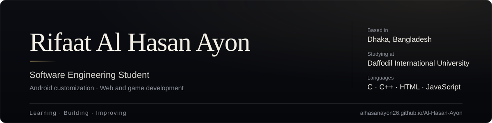

## Delivery pipeline

  

**Al Hasan Ayon** · Frontend or full-stack engineer

## Operating principles

<pre><code>ROLE        = Frontend or full-stack engineer
LOCATION    = Dhaka, Bangladesh 
PUBLIC_REPOS = 28
COMMUNITY   = 0 followers</code></pre>

Software Engineer.

## Uptime in motion

  

## Service signals

  

<code>202 contributions</code> · <code>20 day streak</code>

## Infrastructure shipped

- **[CN-Notification-Issue-Fix](https://github.com/alhasanayon26/CN-Notification-Issue-Fix)** — Fix not delay and no incoming notifications from apps in phones having China rom.  · ⭐ 2
- **[HyperOS-Lite-Launcher](https://github.com/alhasanayon26/HyperOS-Lite-Launcher)** — This launcher is for low end Xiaomi Redmi and Poco devices. It enables Unlocking animation, app opening and closing animation, circle to search, stack or ios style recents menu and many more customizations but still a cutdown version of HyperOS launcher Mod (like- all type of blur features are not available) for better performance. · ⭐ 1
- **[EliteX-HyperOS3-Enhancement](https://github.com/alhasanayon26/EliteX-HyperOS3-Enhancement)** — Enables quick share in cn rom,  Xiaomi EU like specs in settings, enables performance mode, enables highend features, has lite blur with animations and extended power menu for os3, AOD linkage animation, 90Hz refresh rate unlocked, hides root through zygisk and some performance tweaks at the same time! · ⭐ 1
- **[alhasanayon26](https://github.com/alhasanayon26/alhasanayon26)** — Featured public work · ⭐ 0
- **[Neon-Snake](https://github.com/alhasanayon26/Neon-Snake)** — Featured public work · ⭐ 0
- **[EchoLink](https://github.com/alhasanayon26/EchoLink)** — EchoLink: turn your phone into a wireless speaker for your PC. Share your computer’s audio to any phone browser with a 4-digit code. No app, no account. Built with WebRTC and PeerJS. · ⭐ 0

## Platform toolkit

<code>alhasanayon26@github:~$ toolbox --list</code>

  

## Keep it moving

  

<a href="https://github.com/alhasanayon26">GitHub</a> · <a href="https://alhasanayon26.github.io/Al-Hasan-Ayon">Website</a>

Al Hasan Ayon · DevOps profile generated with <a href="https://www.gitskins.com/readme-generator">GitSkins</a>

